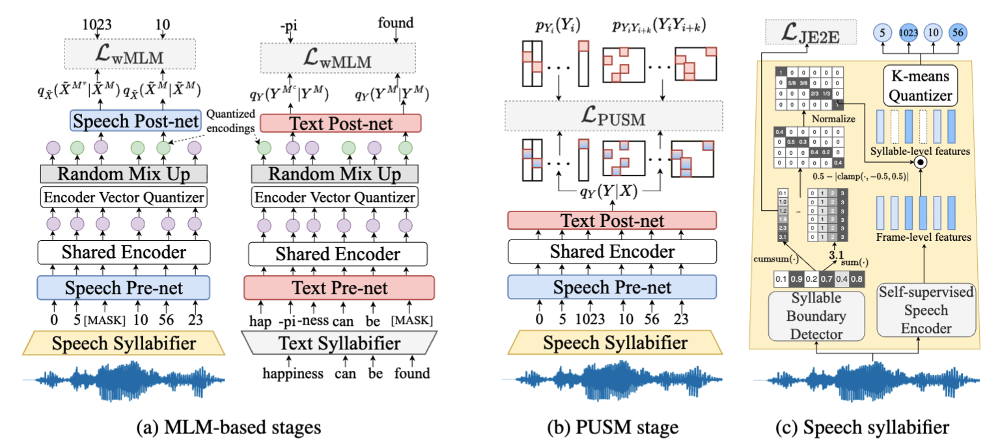

# SylCipher


Syllable-level unsupervised ASR. SylCipher adapts the JSTTI / PUSM training recipe from [Towards Unsupervised Speech Recognition Without Pronunciation Models](https://github.com/JeromeNi/wholeword-uasr-jstti) (Ni et al., [arXiv:2406.08380](https://arxiv.org/abs/2406.08380)) to **syllable units** produced by [Sylber](https://github.com/Berkeley-Speech-Group/sylber) (or a compatible syllable segmenter). 

The model maps unpaired speech (quantized syllable-level features) and unpaired text (syllable or character tokens) with a SpeechT5-style encoder trained under fairseq.

If you find this project to be useful, please consider cite our EMNLP 2026 [paper](https://arxiv.org/pdf/2510.03639).
~~~~
@inproceedings{wang2026sylcipher,
  author    = {Liming Wang and Kai-Wei Chang and Kunio Kashino and David Harwath and Mark A. Hasegawa-Johnson and James R. Glass},
  title     = {Unsupervised Speech Recognition at the Syllable Level},
  booktitle = {EMNLP},
  year      = {2026},
}
~~~~

## Repository layout

| Path | Role |
|------|------|
| `SpeechT5/SpeechSyllableT5/` | Training and inference scripts for the MLM-based stages (`--user-dir .../speecht5`) |
| `SpeechT5/SpeechSyllableT5_transfer_learning/` | Transfer-learning user-dir (MDCC / SuiSiann joint) |
| `SpeechT5/SpeechSyllableT5_transfer_learning_multilingual/` | Multilingual / transfer-learning variant used for MLS and joint training |
| `SpeechT5/SpeechSyllableT5_*uniskip*` | Training and inference scripts for the PUSM stage |
| `train_sylcipher_libri_clean_vad/` | LibriSpeech (VAD-cleaned) data prep + training |
| `train_sylcipher_mls/` | Multilingual LibriSpeech data prep + training |
| `train_syllable_jstti_encoder_aishell_3_vad_char/` | AISHELL-3 character-level data prep |
| `train_syllable_jstti_encoder_aishell_3_vad_with_tone/` | AISHELL-3 pinyin-with-tone data prep + training |
| `train_sylcipher_mdcc_char/` | MDCC data prep (jyutping / character) + optional MDCC-only SylCipher |
| `train_sylcipher_aishell3_mdcc_suisiann/` | Joint AISHELL-3 + MDCC + SuiSiann SylCipher |
| `train_pusm_mdcc/` | MDCC PUSM (jyutping, 608 / 1680 units) |
| `train_pusm_mdcc_char/` | MDCC PUSM (raw characters, 1024 units) |
| `train_pusm_suisiann/` | SuiSiann PUSM (1024 units) |
| `train_pusm_*` | Other PUSM (position-unigram + skipgram matching) baselines |
| `sylber/` | pyphen / **pyphen+** text units (see `sylber/README.md`) |
| `superbpe/` | SuperBPE tokenizer + **BPE+** matching (see `superbpe/README.md`) |
| `path.sh` | Machine-specific paths sourced by the run scripts |

## Environment setup

You will typically need **two or three conda environments**.

### 1. Main training environment (`fairseq`)

The implementation is a SpeechT5 / fairseq user-dir (same stack as [wholeword-uasr-jstti](https://github.com/JeromeNi/wholeword-uasr-jstti)). Create an environment that includes:

- **fairseq v0.12.x** (closest compatible release; install from source)
- **PyTorch** 1.9+ (CUDA build matching your GPUs)
- `faiss`, `editdistance`, `kenlm`, `npy-append-array`
- `hydra-core`, `omegaconf`, `tensorboardX`, `sentencepiece`, `pyphen`
- `soundfile`, `scipy`, `scikit-learn`

```bash
conda create -n fairseq python=3.8
conda activate fairseq
pip install -r requirements.txt

git clone https://github.com/facebookresearch/fairseq.git -b v0.12.2
cd fairseq
pip install -e .
```

Set `FAIRSEQ_ROOT` to that checkout. `fairseq-train` and `fairseq-hydra-train` must be on `PATH`.

For KenLM metrics / language-model scoring, build [kenlm](https://github.com/kpu/kenlm) and point `KENLM_ROOT` at `kenlm/build/bin`.

### 2. Sylber segmentation environment (`sylber`)

Follow [Sylber](https://github.com/Berkeley-Speech-Group/sylber) to extract syllable boundaries. Clone it next to this repo (or set `SYLBER_ROOT`) and keep a separate conda env. The MLS prepare script calls:

```bash
cd $SYLBER_ROOT
conda activate sylber
python extract_boundary.py --wav-dir ... --file-list ... --out-path .../sylber_bnd/${split}_data_bnd_dict.pkl
```

### Optional environments

- **XEUS / ESPnet** if you extract XEUS layer features (`prepare_audio_xeus.sh` activates `espnet2`).
- **HuBERT / WavLM** checkpoints from [fairseq HuBERT](https://github.com/facebookresearch/fairseq/blob/main/examples/hubert/README.md) or Hugging Face.
- **SuperBPE** (`conda create -n superbpe python=3.12 rust`) for BPE+ text units. See `superbpe/README.md`. Point `SUPERBPE_ENV` in `path.sh` if you use a different env name.

### Configure paths

Edit `path.sh` (or export the same variables) **before** submitting jobs:

```bash
source /path/to/SylCipher/path.sh
# defaults you will almost always override:
#   FAIRSEQ_ROOT, CONDA_ROOT, CONDA_ENV
#   MANIFEST_ROOT   # prepared tsv / features / km dirs
#   DATA_ROOT       # raw wav roots (LibriSpeech, MLS, AISHELL-3, MDCC, SuiSiann)
#   MODEL_ROOT      # HuBERT / XEUS checkpoints
#   SYLBER_ROOT
#   SUPERBPE_ENV    # conda env for BPE+ (default: superbpe)
```

Scripts resolve the repo root from their own location and then `source ../path.sh`. Dataset paths still have experiment-specific defaults under `$MANIFEST_ROOT`; change those variables at the top of each script if your layout differs.

## Data preparation

The JSTTI data layout is reused. After preparation you should have, for each corpus:

```
$MANIFEST_ROOT/<corpus>/feat_<feature>_<seg>/top_<K>/km_dir_<K>/
├── discrete_speech_{train,valid,test,...}_clsattnbndkmeans/
│   ├── file_list.txt
│   ├── data.npy / data.lengths          # frame-level SSL features
│   ├── data_dict_bnd.pkl                # syllable boundaries (GradSeg-style)
│   ├── data.km                          # syllable-level k-means tokens
│   ├── data_frame_clus.km               # optional frame clusters
│   └── meta_data.json                   # transcripts for validation WER
├── text_{train,valid,...}/              # fairseq .bin/.idx text
├── dict.txt / dict.audio.txt
└── seg_feats/km_model.npy               # k-means centroids
```

`create_data_dir_sylber.sh` only creates the directory tree and softlinks. Feature pooling and quantization are separate.

### A. LibriSpeech (train-clean-100 + train-clean-360, VAD)

1. Download LibriSpeech from [OpenSLR-12](https://www.openslr.org/12/) and run VAD / silence removal (rVAD, same idea as wav2vec-U).
2. Extract frame-level SSL features (default: HuBERT-Large layer 21) into `$MANIFEST_ROOT/librispeech_clean_vad/feat_hubert_large_L21/`.
3. Run Sylber (or copy existing `*_data_bnd_dict.pkl`) into `$MANIFEST_ROOT/librispeech_clean_vad/sylber_bnd/`.
4. Build the JSTTI folder tree, pool syllable features, train k-means, and binarize text:

```bash
cd train_sylcipher_libri_clean_vad
source ../path.sh
conda activate fairseq

# stage 0: folder tree + feature softlinks
bash create_data_dir_sylber.sh 2048

# stage 1: pool syllable features, k-means, write data.km
bash prepare_sylber_features.sh 2048

# stage 2: syllable text (pyphen+) + fairseq preprocess
bash prepare_text_sylber.sh 2048
```

`prepare_text_sylber.sh` calls `data_curation/extract_text_no_prune.py` and `$FAIRSEQ_ROOT/fairseq_cli/preprocess.py`. Provide `ls_train_clean_vad_syllable_pyphen_plus_{train,valid,valid_true}.json` (or change `--meta_template`).

Semi-unpaired text (NewsCrawl / Wikipedia mixed into the text stream) is optional: `train_libri_sylber_bnd_semi_unpaired.slurm` and `data_curation/prepare_mixed_text.sh`.

### B. Multilingual LibriSpeech (MLS)

`train_sylcipher_mls/prepare_mls.slurm` is a staged pipeline (set `stage` / `stop_stage`):

| Stage | What it does |
|------:|--------------|
| 0 | `utils/prepare_mls.py` — MLS manifests (hours subsample) |
| 10–20 | rVAD + `utils/remove_silence.py` |
| 30 | TSV → `*_file_list.txt` |
| 40 | `create_data_dir_sylber.sh` |
| 50 | XEUS features via `prepare_audio_xeus.sh` (env: `espnet2`) |
| 60–70 | Sylber boundaries (`$SYLBER_ROOT/extract_boundary.py`) |
| 80 | `prepare_sylber_features_sls.sh` — pool + k-means |
| 90 | `prepare_text_sls.sh` — text dict + fairseq binarize |

```bash
cd train_sylcipher_mls
# language is the second argument (dutch|french|german|italian)
sbatch prepare_mls.slurm 0 german
# or launch several languages:
bash run.sh
```

### C. AISHELL-3

Character-level prep lives in `train_syllable_jstti_encoder_aishell_3_vad_char/`:

```bash
cd train_syllable_jstti_encoder_aishell_3_vad_char
sbatch prepare_aishell_3.slurm          # resample, VAD, features
bash create_data_dir.sh
bash prepare_sylber_features.sh
bash prepare_text.sh
```

Pinyin-with-tone variants: `train_syllable_jstti_encoder_aishell_3_vad_with_tone/` (`prepare_*.sh`, then the `train_aishell_3_*.sh` jobs).

### D. MDCC (Cantonese)

Download [MDCC](https://github.com/HLTCHKUST/MDCC) and point `DATA_ROOT` so wavs/transcripts sit at `$DATA_ROOT/MDCC/dataset` (`transcription/` next to the audio). Prep lives in `train_sylcipher_mdcc_char/` (there is no separate `train_sylcipher_mdcc/` folder).

Two text granularities share the same Sylber-segmented XEUS features under `$MANIFEST_ROOT/mdcc_vad`:

| Text | Manifest | Units | Prep job |
|------|----------|------:|----------|
| Jyutping, no tone | `mdcc_vad` | 608 | `prepare_mdcc.py --no-tone True` then pool/k-means at `topk=608` |
| Jyutping + tone | `mdcc_vad` | 1680 | `sbatch prepare_mdcc_with_tone.slurm` |
| Raw characters | `mdcc_vad_raw_character` | 1024 | `sbatch prepare_mdcc.slurm` |

```bash
cd train_sylcipher_mdcc_char
source ../path.sh
conda activate fairseq

# staged pipeline (override with: stage=0 stop_stage=80 sbatch ...)
#  0  transcripts   10–20 rVAD+silence   30 file lists
#  40 JSTTI tree    50 XEUS (espnet2)    60 Sylber ($SYLBER_ROOT)
#  70 pool+k-means  80 fairseq text
sbatch prepare_mdcc.slurm 0                 # character split (1024)
sbatch prepare_mdcc_with_tone.slurm 0       # jyutping+tone (1680)
```

`ToJyutping` must be installed for jyutping (`pip install ToJyutping`). Character jobs reuse phonetic Sylber features from `mdcc_vad`.

PUSM:

```bash
cd train_pusm_mdcc
# stage 1: create_data_dir   |  10: train   |  20: dump
sbatch train_pusm_4gpu_mdcc.slurm              # 608, no tone
sbatch train_pusm_4gpu_mdcc_with_tone.slurm    # 1680, with tone

cd ../train_pusm_mdcc_char
sbatch train_pusm_4gpu_mdcc_char.slurm         # 1024 characters
```

MDCC-only SylCipher (optional, not the joint model):

```bash
cd train_sylcipher_mdcc_char
sbatch train_sylcipher_mdcc_sylber_bnd.slurm   # 608-unit codebook
```

### E. SuiSiann (Taiwanese)

Place the corpus so `$DATA_ROOT/SuiSiann/0.2.1/SuiSiann.csv` exists, with VAD wavs under `$MANIFEST_ROOT/suisiann_vad/wavs` and a fairseq TSV at `$MANIFEST_ROOT/suisiann/{train,dev,test}.tsv`. Transcripts (Tai-lo, optional tone stripping):

```bash
source path.sh
conda activate fairseq
python train_sylcipher_mdcc_char/utils/prepare_suisiann.py \
  --audio-dir ${MANIFEST_ROOT}/suisiann_vad/wavs \
  --text-path ${DATA_ROOT}/SuiSiann/0.2.1/SuiSiann.csv \
  --tsv-path ${MANIFEST_ROOT}/suisiann/train.tsv \
  --out-path ${MANIFEST_ROOT}/suisiann/train_gradseg_style.json \
  --bad-path ${MANIFEST_ROOT}/suisiann/train_bad_files.txt \
  --no-tone False
```

Feature / Sylber / k-means follow the MDCC recipe (`create_data_dir_sylber.sh`, XEUS, `$SYLBER_ROOT/extract_boundary.py`, pool at 1024). The PUSM default segmenter name is `sylber_ft_bnd_aishell3` (AISHELL-3-finetuned Sylber).

```bash
cd train_pusm_suisiann
bash create_data_dir_sylber.sh sylber_ft_bnd_aishell3 1024
sbatch train_pusm_4gpu_suisiann.slurm
```

### F. Joint AISHELL-3 + MDCC + SuiSiann

After each language has its own km_dir and a transferred SylCipher checkpoint:

- AISHELL-3 (no-tone pinyin): `$MANIFEST_ROOT/aishell_3_vad_pinyin_no_tone/.../km_dir_2048`
- MDCC: `$MANIFEST_ROOT/mdcc_vad/.../km_dir_608` + `sylcipher_transfer_aishell_3/checkpoint_best.pt`
- SuiSiann: `$MANIFEST_ROOT/suisiann_vad/.../km_dir_1024` + `sylcipher_transfer_aishell_3/checkpoint_best.pt`

`transfer_weights.py` copies prenet/postnet rows into a new codebook. `combine_weights.py` concatenates the three checkpoints into a shared 2063-unit codebook under `$MANIFEST_ROOT/aishell3_mdcc_suisiann/feat_xeus_L18_sylber_bnd/top_2048/km_dir_2048`.

```bash
cd train_sylcipher_aishell3_mdcc_suisiann
source ../path.sh

# optional: transfer AISHELL-3 weights into SuiSiann (stage 0 of the first slurm)
python transfer_weights.py \
  --src_dir ${MANIFEST_ROOT}/aishell_3_vad_pinyin_no_tone/feat_xeus_L18_sylber_ft_stage2_bnd/top_2048/km_dir_2048 \
  --ckpt_path ${MANIFEST_ROOT}/aishell_3_vad_pinyin_no_tone/feat_xeus_L18_sylber_ft_stage2_bnd/top_2048/km_dir_2048/model_codebook_0.3_encoder_only_sylber_bnd_diff_bnd_with_uniskip_v2/checkpoint_best.pt \
  --tgt_dir ${MANIFEST_ROOT}/suisiann_vad/feat_xeus_L18_sylber_ft_bnd/top_1024/km_dir_1024 \
  --out_ckpt_path ${MANIFEST_ROOT}/suisiann_vad/feat_xeus_L18_sylber_ft_bnd/top_1024/km_dir_1024/sylcipher_transfer_aishell_3/checkpoint_best.pt

python combine_weights.py   # reads $MANIFEST_ROOT; override --src-dirs / --ckpt-paths if needed

sbatch train_sylcipher_aishell3_mdcc_suisiann_sylber_bnd.slurm                          # SpeechSyllableT5_transfer_learning
sbatch train_sylcipher_aishell3_mdcc_suisiann_sylber_bnd_transfer_learning.slurm        # multilingual user-dir
sbatch train_sylcipher_aishell3_mdcc_suisiann_sylber_bnd_transfer_learning_uniskip.slurm  # PUSM / uniskip
```

Eval dumps `test{0,1,2}` (AISHELL-3, MDCC, SuiSiann). `--km-size` is 2063.

### G. pyphen+ text units (English)

See [`sylber/README.md`](sylber/README.md). **pyphen+** is Pyphen hyphenation plus extra English phonological rules. `train_sylcipher_libri_clean_vad/prepare_text_sylber.sh` expects `ls_train_clean_vad_syllable_pyphen_plus_{train,valid,valid_true}.json`.

```bash
cd sylber
python extract_libri_gt_syllable_boundary_pyphen_extra_rules.py \
  --filelist ${MANIFEST_ROOT}/librispeech_clean_vad/train_file_list.txt \
  --align_dir /path/to/LibriSpeech/MFA/alignments \
  --output_prefix ${MANIFEST_ROOT}/librispeech_clean_vad/train_syllable_pyphen_plus
```

Unpaired LM text: `extract_libri_gt_syllable_boundary_pyphen_plus_unpaired.py`.

### H. BPE+ text units

See [`superbpe/README.md`](superbpe/README.md). Train SuperBPE, match pieces to a pyphen+ dictionary (`match_tokens.py`), then greedy-tokenize (`greedy_tokenize.py`).

```bash
source path.sh
conda activate "${SUPERBPE_ENV}"
cd superbpe
sbatch run_libri_clean_vad.sh          # edit s/e: 0–1 train, 10 match, 30 greedy BPE+
sbatch run_mls.slurm german
```

## Train SylCipher

Training is `fairseq-train` with `--task speecht5 --t5-task discrete_pretrain_gan`. Stop when validation WER (`uer` in the logs) flattens. Adjust `--distributed-world-size`, `--update-freq`, and the SLURM `#SBATCH` GPU request to your cluster.

### LibriSpeech

```bash
cd train_sylcipher_libri_clean_vad
# edit stage window at the top of the script: s / e
#   0–2  data prep   |  10  train   |  20  decode
sbatch train_libri_sylber_bnd.slurm
```

`--user-dir` defaults to `SpeechT5/SpeechSyllableT5/speecht5`. After training, stage 20 runs `SpeechT5/SpeechSyllableT5/dump_prediction_multilevel.py` and writes hypotheses next to the checkpoint.

### MLS (shared multilingual codebook)

```bash
cd train_sylcipher_mls
sbatch train_sylcipher_mls_sylber_bnd.slurm   # from-scratch / shared codebook
sbatch train_sylcipher_mls_je2e.slurm         # joint E2E refinement (loads the shared ckpt)
```

These use `SpeechT5/SpeechSyllableT5_transfer_learning_multilingual/speecht5`. Evaluation dumps one `test{i}` split per language (`--num-lang 4`).

### AISHELL-3

```bash
cd train_syllable_jstti_encoder_aishell_3_vad_with_tone
sbatch train_aishell_3_top_2048_jstti_enc_sylber_ft_stage2_bnd.sh
```

### MDCC / SuiSiann / joint

See data-prep sections D–F. Joint training:

```bash
cd train_sylcipher_aishell3_mdcc_suisiann
sbatch train_sylcipher_aishell3_mdcc_suisiann_sylber_bnd.slurm
```

### Typical knobs

Copied from the JSTTI recipe; syllable vocab sizes are usually 1024 / 2048 / 4096.

- `--km-size` must match the k-means codebook
- `--init-clus-dir` points at `seg_feats/km_model.npy`
- `--update-freq` should be large enough that one epoch is a small number of optimizer steps (PUSM requires **exactly one** update per epoch)
- `--word-freq` / `--word-count-loss-weight` — start near 16 / 5e5 for 2048 units
- To resume after a crash, comment out `--reset-optimizer`, `--reset-lr-scheduler`, `--no-load-quantizer`, `--no-load-policy`

## Train PUSM baselines (optional)

PUSM is the linear-generator baseline from the JSTTI paper (wav2vec-U template). Each `train_pusm_*` folder is a fairseq `--user-dir` (`tasks/`, `models/`, `data/`, `config/gan/`).

Make sure the JSTTI tree already contains `feats` in `discrete_speech_*` **and** `text_train` (see `create_data_dir_sylber.sh` in each PUSM folder, which converts `data.km` → the `.npy` the PUSM loader expects).

```bash
# LibriSpeech, interleaved unigram/skipgram, 2048 units
cd train_pusm_libri_clean_vad
# stage 1: create_data_dir   |  10: train   |  20: dump predictions
sbatch train.slurm

# MLS, one language
cd train_pusm_mls
sbatch train_pusm_4gpu_mls.slurm german 0 1

# AISHELL-3 characters
cd train_pusm_aishell_3_char
sbatch train_pusm_4gpu_aishell_3_char.slurm

# MDCC jyutping (608) / characters (1024)
cd train_pusm_mdcc && sbatch train_pusm_4gpu_mdcc.slurm
cd train_pusm_mdcc_char && sbatch train_pusm_4gpu_mdcc_char.slurm

# SuiSiann
cd train_pusm_suisiann && sbatch train_pusm_4gpu_suisiann.slurm
```

`fairseq-hydra-train` reads `config/gan/l1_w2vu_*clus.yaml`. Set `update_freq` / `batch_size` so **each epoch is a single update**: odd epochs collect corpus unigram/skipgram statistics with a frozen generator; even epochs accumulate the generator gradient.

Decode with `dump_prediction_multilevel_pusm.py` (or `_char.py` for characters), which is already wired as stage 20 in the slurm files.

## Evaluate

From a SpeechSyllableT5 directory:

```bash
source /path/to/SylCipher/path.sh
cd $SYLCIPHER_ROOT/SpeechT5/SpeechSyllableT5

python dump_prediction_multilevel.py $DATA_DIR \
  --ckpt-path $SAVE_DIR/checkpoint_best.pt \
  --user-dir $SYLCIPHER_USER_DIR \
  --max-text-positions 100 \
  --split "discrete_speech_valid_true_clsattnbndkmeans|text_valid_true" \
  --postfix "valid_true_layer_0" \
  --use-discrete-labels 0 \
  --tgt-enc-layer 0
```

Use `--use-discrete-labels 0` when the CNN / soft pooler is active (E2E refinement); `1` when you decode pre-quantized `data.km` tokens. Related helpers: `dump_boundary.py`, `dump_embedding.py`, `dump_prediction_sclite.py`.

Boundary quality (Sylber vs. forced alignment, GradSeg-style pickles):

```bash
cd train_sylcipher_libri_clean_vad
python eval_boundaries_gradseg_format.py ...
python eval_segmentation.py ...
```

## Checkpoints and cluster notes

- Jobs were developed on SLURM (`#SBATCH -p a5/a6`, 1–8 GPUs). Edit the headers for your partition.
- `logs/` is gitignored; slurm scripts write `logs/%j_*.{out,err}`.
- Manifests, `.npy` features, and trained checkpoints are **not** in this repo. Point `MANIFEST_ROOT` / `SAVE_DIR` at a scratch disk with enough space.
- A few dump / SpokenCOCO helper scripts still contain leftover `/nobackup/...` comments from earlier machines; the live `USER_DIR` / conda paths go through `path.sh`.

## Related code

- Whole-word JSTTI / PUSM (data-folder conventions, loss terms, wav2boundaries recipe): https://github.com/JeromeNi/wholeword-uasr-jstti
- SpeechT5: https://github.com/microsoft/SpeechT5
- wav2vec-U: https://github.com/facebookresearch/fairseq/tree/main/examples/wav2vec/unsupervised
- Sylber: https://github.com/Berkeley-Speech-Group/sylber
- SuperBPE: https://github.com/PythonNut/superbpe
- MDCC: https://github.com/HLTCHKUST/MDCC
- SuiSiann: https://suisiann.ithuan.tw/
